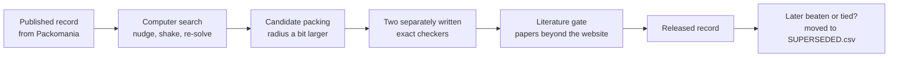

# Packing equal circles, spheres and hyperspheres: 4,063 best-known records still standing (2026-10-18)

**How many equal coins fit in a box, and how big can they be? We released 6,071 packings that beat the best-known
records in 21 containers, from triangles to six-dimensional balls. Others have since beaten or tied 2,008 of them, so on
2026-10-18 4,063 were still the best known. Every one comes with a certificate that two separately written checkers
verify in exact arithmetic, with no rounding. And for 16 circles in an equilateral triangle we proved that the best
packing known since 1995 is optimal (computer-assisted; the best radius is pinned to within 3.6 x 10^-34, and the proof
does not decide between the two known arrangements).**

[](https://doi.org/10.5281/zenodo.22981305)

Moki & Julio

**Records** [RESULTS_TABLE.md](RESULTS_TABLE.md) · **Since beaten** [SUPERSEDED.csv](SUPERSEDED.csv) · **Check**
`python verify.py` · **Proof** [proofs/triangle16/](proofs/triangle16/) · **Full history** [TECHNICAL.md](TECHNICAL.md)

## The story in a minute

Take N equal coins and a tray of a fixed shape. Make the coins as large as possible without overlapping each other or
the edge. Proofs of the best answer exist only for some small or special N (for the equilateral triangle: N <= 15,
N = 20 and the triangular numbers), so mathematicians keep a public scoreboard of the best packings found so far: E. Specht's record tables at [Packomania](https://www.packomania.com/).

A picture that helps: **a parking lot with painted bays.** You want the widest possible bays for a given number of cars.
Where the picture breaks: our "cars" are perfect circles (or balls), the lot can be a triangle, a sphere or a ball in
six dimensions, and the question is only about the biggest equal size, not about how cars get in.

We searched with a computer and found packings that beat 6,071 entries across 21 of those tables. Then others moved the
frontier: by 2026-10-18 others had published better packings for 1,974 of them (sometimes a packing with more
circles, minus the extras) and tied 34. We no longer claim those
2,008; each one, with its source, is listed in [SUPERSEDED.csv](SUPERSEDED.csv). That leaves **4,063** still best-known
on that date.

A record says "nobody has found better", not "nothing better exists". For one case we went further: for 16 equal
circles in an equilateral triangle, the packing found in 1995 by Melissen & Schuur and by Graham & Lubachevsky is
**optimal**. That proof is computer-assisted. Two such arrangements are known, and the proof does not say which of
them is optimal, or whether both are.

## Climb the ladder

### Step 1 - the idea (for anyone)


Better packing is a search problem with a strict referee at the end.



### Step 2 - how it works (for a curious student)

The search moves the centres of the N circles so that the smallest gap, circle to circle or circle to wall, keeps
growing. It alternates small steps (linear programming, a standard method for improving many linked quantities at once, on the gaps that matter) with big jumps (move the circle with the
fewest contacts into the largest hole), and keeps only improvements.

A worked example: 10 equal circles in a rectangle 1 wide and 0.8 tall (table `crc_800`, the picture above).

| | radius |
|---|---|
| Packomania record | 0.134224258574381790065222795652 |
| ours | 0.134722358359009814268885166349 |
| gain | +0.371 % (a new arrangement) |

The certificate `crc_800_10.txt` is just the radius and ten centres, written as decimals. Checker A reads every decimal
as an exact fraction and tests two things: every circle lies inside the rectangle, and every pair of centres is at
least two radii apart. No floating point takes part in any decision. Checker B, written separately, does the same in
its own way. A record counts only if both say `IMPROVES`, and only if the gain is more than one part in 10^10; smaller
gains count as ties, because published values can be low in their last digits.

### Step 3 - the real thing (for specialists)

- **Records.** 6,071 packings released (by v2.6, 2026-09-26; v2.7 added the proof) in 21 Packomania tables: rectangles, triangle, quadrant, semicircle,
  square, regular 5-, 6-, 15- and 16-gons, spheres in a cube and in a sphere, balls in the 4-, 5- and 6-ball. On
  2026-10-18: 1,974 beaten, 34 tied, 4,063 still best-known.

  | table | released | beaten | tied | still best-known |
  |---|---|---|---|---|
  | `csq` (square) | 2,213 | 1,727 | 0 | 486 |
  | `scu` (spheres in a cube) | 455 | 189 | 34 | 232 |
  | `hsp6` (6-D balls) | 77 | 54 | 0 | 23 |
  | `hsp5` (5-D balls) | 169 | 3 | 0 | 166 |
  | `ssp` (spheres in a sphere) | 587 | 1 | 0 | 586 |
  | the other 16 tables | 2,570 | 0 | 0 | 2,570 |
  | **total** | **6,071** | **1,974** | **34** | **4,063** |

- **Certificates.** Exact, verified by two independently written checkers (pure rational arithmetic, or exact integer
  tests for spheres and balls; irrational walls by exact algebra or rigorous rational enclosures).
- **Local optimality.** For 1,340 packings, two checkers prove that no small nudge beats them (radius at most ours +
  Delta within an explicit distance rho; Delta <= 3e-22 r). The other 4,731 are not claimed locally optimal.
- **Proof, N = 16 in a triangle.** Computer-assisted (exact branch-and-bound plus exact rational certificates):
  r16 = 0.0786557494924822861883484505248561..., enclosed to within 3.6 x 10^-34. The certificate encloses both known
  optimal arrangements and does not decide between them. Optimality was known for N <= 15, N = 20 and every triangular
  number; for N = 16 the repository's literature search found no earlier proof. Write-up: [proofs/triangle16/](proofs/triangle16/).

Every version's details, claim policies, prior art and credits: [TECHNICAL.md](TECHNICAL.md).

## Use it as a tool

Questions this lets you answer:

- What is the best-known radius for N equal circles in one of these 21 containers, and where are the centres?
- Is a packing you found really valid, and does it beat a given radius? (Feed it to our exact checkers.)
- Which of our released records still stand?

**Verify every record** (Python 3.9+, standard library only; about 5-15 minutes on 12 threads):

```
git clone https://github.com/Hashirama1337s/moki-julio-circle-packing
cd moki-julio-circle-packing
python verify.py
```

Expected last lines: `TOTAL: 6071 / 6071 verified by both checkers` and `FAILURES: none`. It checks the packings as
released; it says nothing about which were later beaten (that is `SUPERSEDED.csv`).

**Check one packing, or your own.** A certificate is a text file: first line `r <radius>`, then one line of
coordinates per centre, in Packomania's frame (for `crc_800`: width 1 x height 0.8, centred at the origin).

```
python -c "import zipfile;zipfile.ZipFile('certificates/crc_800.zip').extract('crc_800_10.txt')"
python checkers/certify_circ.py rect:0.8 crc_800_10.txt 0.134224258574381790065222795652
python checkers/verify_exact_rect_quad.py rect:0.8 crc_800_10.txt 10 0.134224258574381790065222795652
```

Both end with `VERDICT: IMPROVES`. Replace the file with your own packing and the last number with the radius to beat.
Other containers have their own checkers (listed in [TECHNICAL.md](TECHNICAL.md), "Verify it yourself").

**Which records still stand?** From the two CSV files:

```python
import csv
released = list(csv.DictReader(open('MANIFEST.csv')))
gone = {(r['table'], r['N']): r['status'] for r in csv.DictReader(open('SUPERSEDED.csv'))}
standing = [r for r in released if (r['shelf'], r['N']) not in gone]
print(len(released), 'released;', len(gone), 'beaten or tied;', len(standing), 'still best-known on 2026-10-18')
sq = [r for r in standing if r['shelf'] == 'csq']
print('square, still standing:', len(sq), '- first few N:', [int(r['N']) for r in sq][:5])
```

It prints `6071 released; 2008 beaten or tied; 4063 still best-known on 2026-10-18` and 486 for the square.

## What we did not show

- A record is not a proof of optimality. Only N = 16 in the triangle is proved optimal here; 1,340 packings are
  certified locally optimal (no small nudge beats them, up to a margin of at most 3e-22 of the radius), which is weaker.
- 2,008 released records have since been beaten or tied by others. The "still best-known" count is as of 2026-10-18.
  Some sources could not be checked (paywalled data, one repository that reports re-polishing an unnamed set, and
  Packomania's queue of submissions that are not public yet); any of these may change the count.
- Correction (credit): the zig-zag theorem we published in v1.4 as our own is Lemma 3 of M. Ruda (1970). The 58
  rectangle entries we called "newly proven" are his results, and our proofs for 4 circles in the 1 x 0.8 and 6 circles
  in the 1 x 0.6 rectangles are later, independent, machine-checked proofs of his statements.
- 331 packings that beat the website were not claimed, because two papers (Lai, Hao, Yue & Zhou 2025; López & Beasley
  2011) had better or unpublished values there.
- The triangle proof encloses the optimum but does not say which of the two known arrangements is optimal, or whether
  both are, and proves nothing for other N.

## Words you will meet

- **Packing** - equal circles (or spheres, or balls) placed in a container without overlapping.
- **Radius** - the common size of the circles; bigger is better for the same N.
- **Best-known record** - the largest radius anyone has published for that N and container.
- **Certificate** - the file of centres and radius that lets anyone check a claim.
- **Exact checker** - a program that decides with fractions or whole numbers, so rounding cannot fool it.
- **Beaten / tied** - a newer packing more than 10^-10 (relative) larger / within 10^-10.
- **Locally optimal** - no small nudge of the circles gives a larger radius (here: up to a margin of at most 3e-22 of
  the radius).
- **Computer-assisted proof** - a proof in which a computer checks a huge but finite list of cases exactly.
- **Hypersphere / 4-, 5-, 6-D ball** - the same idea in more than three dimensions; distances are computed the same
  way, with more coordinates.

## For specialists: the original README

The complete previous README (the 2026-10-18 notice, every version's changes and claim policies, the certificate format,
the checkers, how the packings were found, prior art and credits) is kept verbatim in **[TECHNICAL.md](TECHNICAL.md)**.

Other projects: [github.com/Hashirama1337s](https://github.com/Hashirama1337s)

*Prepared with AI assistance; all results are machine-checked.*
