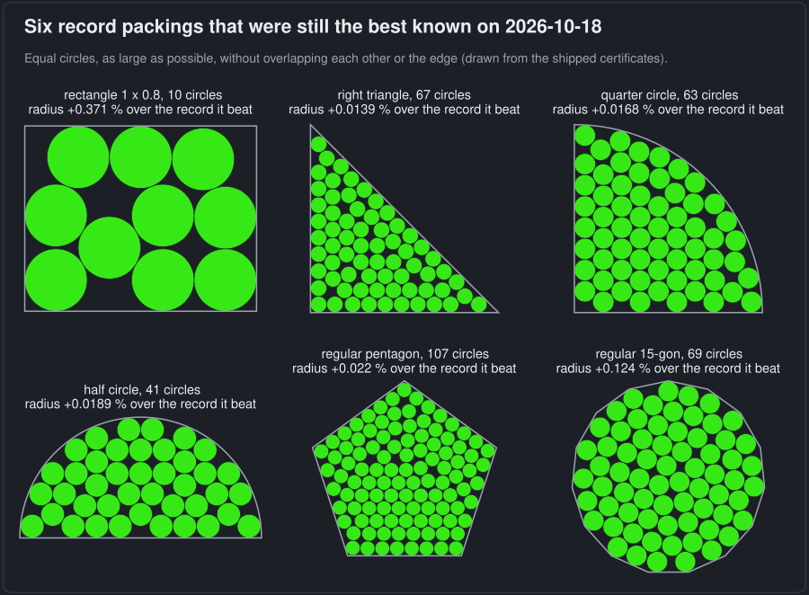
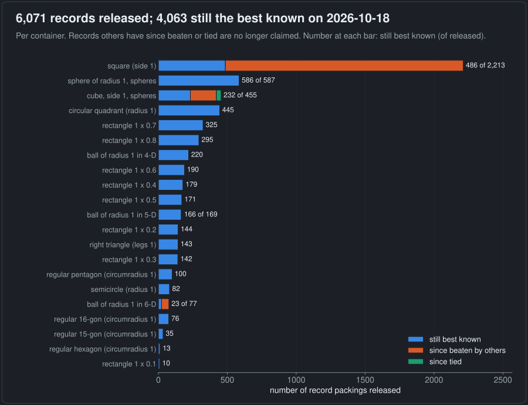
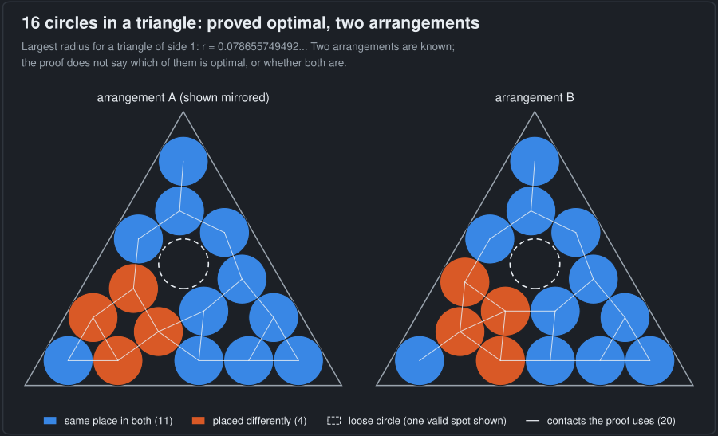
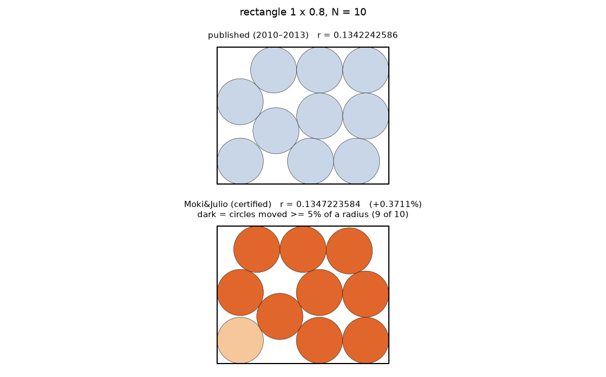
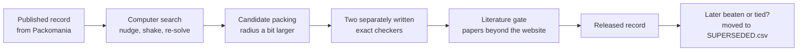

# Packing equal circles, spheres and hyperspheres: record packings with exact certificates

**6,071 record packings of equal circles, spheres and higher-dimensional balls, each verified by two separately written exact checkers; others have since beaten or tied 2,008 of them, and 4,063 were still the best known on 2026-10-18.**

[](https://doi.org/10.5281/zenodo.22981305)  [](https://github.com/Hashirama1337s)

Moki & Julio · 2026 · version 2.7.1

**Records** [RESULTS_TABLE.md](RESULTS_TABLE.md) · **Since beaten** [SUPERSEDED.csv](SUPERSEDED.csv) · **Check**
`python verify.py` · **Proof** [proofs/triangle16/](proofs/triangle16/) · **Full history** [TECHNICAL.md](TECHNICAL.md)

## In plain words

Take N equal coins and a tray of a fixed shape. Make the coins as large as possible without overlapping each other or
the edge. Proofs of the best answer exist only for some small or special N (for the equilateral triangle: N <= 15 and the triangular numbers, and N = 16 in this repository), so mathematicians keep a public scoreboard of the best packings found so far: E. Specht's record tables at [Packomania](https://www.packomania.com/).

 **The idea in one picture.** **A parking lot with painted bays.** You want the widest possible bays for a given number of cars.
**Where the picture breaks.** Our "cars" are perfect circles (or balls), the lot can be a triangle, a sphere or a ball in
six dimensions, and the question is only about the biggest equal size, not about how cars get in.

We searched with a computer and found packings that beat 6,071 entries across 21 of those tables. Then others moved the
frontier: by 2026-10-18 others had published better packings for 1,974 of them (sometimes a packing with more
circles, minus the extras) and tied 34. We no longer claim those
2,008; each one, with its source, is listed in [SUPERSEDED.csv](SUPERSEDED.csv). That leaves **4,063** still best-known
on that date.



*Six of the record packings that were still the best known on 2026-10-18, one per container shape, drawn from the certificates in this repository. In each, equal circles are as large as possible without overlapping each other or the edge. The percentage is how much larger the radius is than the published record it beat. Most gains are small (here 0.014 % to 0.37 %); the pictures show new arrangements, not new kinds of packing.*

A record says "nobody has found better", not "nothing better exists". For one case we went further: for 16 equal
circles in an equilateral triangle, the packing found in 1995 by Melissen & Schuur and by Graham & Lubachevsky is
**optimal**. That proof is computer-assisted. Two such arrangements are known, and the proof does not say which of
them is optimal, or whether both are.

## At a glance

*The exact claims, for specialists. Terms are explained in "How it works" and "Words you will meet".*

- **Records.** 6,071 packings released (by v2.6, 2026-09-26; v2.7 added the proof) in 21 Packomania tables: rectangles, triangle, quadrant, semicircle,
  square, regular 5-, 6-, 15- and 16-gons, spheres in a cube and in a sphere, balls in the 4-, 5- and 6-ball. On
  2026-10-18: 1,974 beaten, 34 tied, 4,063 still best-known.

  | table | released | beaten | tied | still best-known |
  |---|---|---|---|---|
  | `csq` (square) | 2,213 | 1,727 | 0 | 486 |
  | `scu` (spheres in a cube) | 455 | 189 | 34 | 232 |
  | `hsp6` (6-D balls) | 77 | 54 | 0 | 23 |
  | `hsp5` (5-D balls) | 169 | 3 | 0 | 166 |
  | `ssp` (spheres in a sphere) | 587 | 1 | 0 | 586 |
  | the other 16 tables | 2,570 | 0 | 0 | 2,570 |
  | **total** | **6,071** | **1,974** | **34** | **4,063** |

  

  *Every released record, per container, split into those still the best known on 2026-10-18 (blue), those others have since beaten (orange) and those since tied (green). The number at each bar is "still best known of released". Most of the 1,974 beaten records are in the square table (1,727 of 2,213); 34 cube records were tied. We no longer claim any beaten or tied record; each is listed with its source in SUPERSEDED.csv.*

- **Certificates.** Exact, verified by two independently written checkers (pure rational arithmetic, or exact integer
  tests for spheres and balls; irrational walls by exact algebra or rigorous rational enclosures).
- **Local optimality.** For 1,340 packings, two checkers prove that no small nudge beats them (radius at most ours +
  Delta within an explicit distance rho; Delta <= 3e-22 r). The other 4,731 are not claimed locally optimal.
- **Proof, N = 16 in a triangle.** Computer-assisted (exact branch-and-bound plus exact rational certificates):
  r16 = 0.0786557494924822861883484505248561..., enclosed to within 3.6 x 10^-34. The certificate encloses both known
  optimal arrangements and does not decide between them. Optimality was known for N <= 15 and every triangular number; for N = 16 the repository's literature search found no earlier proof. Write-up: [proofs/triangle16/](proofs/triangle16/).



*The two known best packings of 16 equal circles in an equilateral triangle (found in 1995 by Melissen & Schuur and by Graham & Lubachevsky), drawn from this repository's proof certificate. Our computer-assisted proof shows that no packing has a larger radius: r = 0.078655749492... for a triangle of side 1. The two arrangements share 11 circles (blue) and place 4 differently (orange); arrangement A is shown mirrored so the shared circles line up. The dashed circle is loose and can move inside its hole; one valid position is shown. Lines mark the 20 circle-to-circle contacts the proof uses. The proof does not say which arrangement is optimal, or whether both are.*

Every version's details, claim policies, prior art and credits: [TECHNICAL.md](TECHNICAL.md).

## What we do not claim

- A record is not a proof of optimality. Only N = 16 in the triangle is proved optimal here; 1,340 packings are
  certified locally optimal (no small nudge beats them, up to a margin of at most 3e-22 of the radius), which is weaker.
- 2,008 released records have since been beaten or tied by others. The "still best-known" count is as of 2026-10-18.
  Some sources could not be checked (paywalled data, one repository that reports re-polishing an unnamed set, and
  Packomania's queue of submissions that are not public yet); any of these may change the count.
- Correction (credit): the zig-zag theorem we published in v1.4 as our own is Lemma 3 of M. Ruda (1970). The 58
  rectangle entries we called "newly proven" are his results, and our proofs for 4 circles in the 1 x 0.8 and 6 circles
  in the 1 x 0.6 rectangles are later, independent, machine-checked proofs of his statements.
- Correction 2026-11-17: versions up to 2.7 said optimality in the triangle was also known for N = 20 (Payan 1997).
  That was wrong: Payan (1997) proved N = 14 and announced a proof for N = 20 that was not published (Payan 1997,
  Section 8). The sentences have been corrected in this README, TECHNICAL.md and proofs/triangle16/README.md.
- 331 packings that beat the website were not claimed, because two papers (Lai, Hao, Yue & Zhou 2025; López & Beasley
  2011) had better or unpublished values there.
- The triangle proof encloses the optimum but does not say which of the two known arrangements is optimal, or whether
  both are, and proves nothing for other N.

## How it works

### The idea



Better packing is a search problem with a strict referee at the end.



### A worked example

The search moves the centres of the N circles so that the smallest gap, circle to circle or circle to wall, keeps
growing. It alternates small steps (linear programming, a standard method for improving many linked quantities at once, on the gaps that matter) with big jumps (move the circle with the
fewest contacts into the largest hole), and keeps only improvements.

A worked example: 10 equal circles in a rectangle 1 wide and 0.8 tall (table `crc_800`, the picture above).

| | radius |
|---|---|
| Packomania record | 0.134224258574381790065222795652 |
| ours | 0.134722358359009814268885166349 |
| gain | +0.371 % (a new arrangement) |

The certificate `crc_800_10.txt` is just the radius and ten centres, written as decimals. Checker A reads every decimal
as an exact fraction and tests two things: every circle lies inside the rectangle, and every pair of centres is at
least two radii apart. No floating point takes part in any decision. Checker B, written separately, does the same in
its own way. A record counts only if both say `IMPROVES`, and only if the gain is more than one part in 10^10; smaller
gains count as ties, because published values can be low in their last digits.

## Reproduce and reuse

Questions this lets you answer:

- What is the best-known radius for N equal circles in one of these 21 containers, and where are the centres?
- Is a packing you found really valid, and does it beat a given radius? (Feed it to our exact checkers.)
- Which of our released records still stand?

**Verify every record** (Python 3.9+, standard library only; about 5-15 minutes on 12 threads):

```
git clone https://github.com/Hashirama1337s/moki-julio-circle-packing
cd moki-julio-circle-packing
python verify.py
```

Expected last lines: `TOTAL: 6071 / 6071 verified by both checkers` and `FAILURES: none`. It checks the packings as
released; it says nothing about which were later beaten (that is `SUPERSEDED.csv`).

**Check one packing, or your own.** A certificate is a text file: first line `r <radius>`, then one line of
coordinates per centre, in Packomania's frame (for `crc_800`: width 1 x height 0.8, centred at the origin).

```
python -c "import zipfile;zipfile.ZipFile('certificates/crc_800.zip').extract('crc_800_10.txt')"
python checkers/certify_circ.py rect:0.8 crc_800_10.txt 0.134224258574381790065222795652
python checkers/verify_exact_rect_quad.py rect:0.8 crc_800_10.txt 10 0.134224258574381790065222795652
```

Both end with `VERDICT: IMPROVES`. Replace the file with your own packing and the last number with the radius to beat.
Other containers have their own checkers (listed in [TECHNICAL.md](TECHNICAL.md), "Verify it yourself").

**Which records still stand?** From the two CSV files:

```python
import csv
released = list(csv.DictReader(open('MANIFEST.csv')))
gone = {(r['table'], r['N']): r['status'] for r in csv.DictReader(open('SUPERSEDED.csv'))}
standing = [r for r in released if (r['shelf'], r['N']) not in gone]
print(len(released), 'released;', len(gone), 'beaten or tied;', len(standing), 'still best-known on 2026-10-18')
sq = [r for r in standing if r['shelf'] == 'csq']
print('square, still standing:', len(sq), '- first few N:', [int(r['N']) for r in sq][:5])
```

It prints `6071 released; 2008 beaten or tied; 4063 still best-known on 2026-10-18` and 486 for the square.

## Words you will meet

- **Packing** - equal circles (or spheres, or balls) placed in a container without overlapping.
- **Radius** - the common size of the circles; bigger is better for the same N.
- **Best-known record** - the largest radius anyone has published for that N and container.
- **Certificate** - the file of centres and radius that lets anyone check a claim.
- **Exact checker** - a program that decides with fractions or whole numbers, so rounding cannot fool it.
- **Beaten / tied** - a newer packing more than 10^-10 (relative) larger / within 10^-10.
- **Locally optimal** - no small nudge of the circles gives a larger radius (here: up to a margin of at most 3e-22 of
  the radius).
- **Computer-assisted proof** - a proof in which a computer checks a huge but finite list of cases exactly.
- **Hypersphere / 4-, 5-, 6-D ball** - the same idea in more than three dimensions; distances are computed the same
  way, with more coordinates.

## Open doors

Questions this work leaves open, with pointers to the files in this repository that help someone start.

- **Do the two best arrangements of 16 circles in a triangle have exactly the same size.** Two different arrangements of
  16 circles have been known since 1995; Graham and Lubachevsky describe them as equivalent packings that differ in the
  placement of four circles. Our proof puts both into the same interval, less than 4 x 10^-34 wide, around the best
  possible radius, but it cannot tell whether their exact radii are equal, so it does not say whether one of them, or
  both, are optimal. *Status:* UNTESTED observation from this work (not attempted here). *Start here:*
  [proofs/triangle16/](proofs/triangle16/): clusters 0 and 1 are the two arrangements, each held in place by 33 contacts
  (20 circle-to-circle, 13 circle-to-wall) with one loose circle; writing those contacts as exact equations and comparing
  their solutions is one route to the answer. *Ceiling:* the case N = 16 settled completely, including which arrangements
  are optimal.
- **Is the best-known packing of 17 circles in a triangle optimal.** Proofs exist for up to 15 circles, for the triangular
  numbers, and (here) for 16. Our search engine already gives an upper bound for 17 within about 1 part in 10,000 of the
  best-known value (3 - sqrt 3)/6, but that run was checked by one checker only and is not a proof; 18 and 19 were not
  decided (for 18, a second arrangement comes within 4 x 10^-7 of the best). *Status:* open as far as our dated search
  found (2026-11-17; arXiv, Zenodo and web searches for optimality proofs of circle packings in the equilateral triangle,
  and the works citing the 1997 proof for 14 circles). *Start here:* section 9 of [proofs/triangle16/](proofs/triangle16/)
  and its engine `tri_engine.py`, two tree checkers and local-certificate tools; what is missing for 17 is the step that
  pins down every near-best arrangement and certifies it locally. *Ceiling:* a computer-assisted proof for 17 circles,
  checked by two independent programs.
- **Packings that can still wiggle at first order.** Of the 4,731 packings without a local-optimality certificate, 1,012
  have a "first-order flex": a small sliding or buckling motion that the first-order test cannot rule out. We did not
  check whether those motions can actually make the circles larger. *Status:* UNTESTED observation from this work (not
  attempted here). *Start here:* [LOCAL_OPTIMALITY.csv](LOCAL_OPTIMALITY.csv) (verdict per packing; these are the rows
  marked `NOT_RIGID`), `checkers/lopt.py` (the theorem is in its docstring) and `checkers/verify_lopt.py`. *Ceiling:*
  either many more packings certified locally optimal, or explicit small motions that improve some of them.
- **Local optimality for spheres and higher-dimensional balls.** The "no small nudge beats it" certificates were made only
  for circles in two-dimensional containers; for spheres in a cube or a sphere and for balls in 4 to 6 dimensions they
  were not attempted. *Status:* UNTESTED observation from this work (not attempted here). *Start here:* the certificates
  in `certificates/`, the exact ball and cube checkers in `checkers/`, and `checkers/lopt.py` as the two-dimensional model
  to extend. *Ceiling:* certified local optimality for the sphere and ball records that still stand.
- **Do 20 circles fit in a triangle no better than 21.** Twenty-one circles fit perfectly in a triangle as a stack of rows
  (6, 5, 4, 3, 2, 1). A conjecture attributed to Erdős and to Oler says that removing one circle never lets the rest fit
  in a smaller triangle; it is proved for 3, 6, 10 and 15 circles minus one, but not, in print, for 21 minus one.
  *Status:* a published proof for 20 circles: announced by Payan (1997, Section 8: 'the proof being far too long, we will
  not present it in this article'), never published as far as our search of 2026-11-17 found. *Start here:* the engine and checkers in
  [proofs/triangle16/](proofs/triangle16/); unlike 16, the best packing of 20 has a hole, so the local stage has to
  certify a whole family of positions rather than one point. *Ceiling:* the next case of a named conjecture from 1961,
  proved by computer and checked by two programs.

## How to cite

```
Moki & Julio (2026). New best-known packings of equal circles, spheres and hyperspheres in twenty-one Packomania containers (6,071 released; 4,063 still best-known on 2026-10-18). Version 2.7.1. Zenodo. https://doi.org/10.5281/zenodo.22981305
```

The DOI always resolves to the newest archived version. Machine-readable: [CITATION.cff](CITATION.cff).
Code (`verify.py`, `checkers/`, `solver/`, `figures/make_figures.py`): MIT (see `LICENSE-CODE`); everything else CC BY 4.0 (`LICENSE`).

Release note - v2.7.1: adds Open doors and figures; corrections dated 2026-11-17; no change to the certified results.

## Related projects

- [szilassi-12](https://github.com/Hashirama1337s/szilassi-12): two computer-assisted theorems about polyhedra in which every face touches every other
- All projects: [the Moki & Julio lab map](https://github.com/Hashirama1337s)

---

*Prepared with AI assistance; what was checked, and by what, is stated above.*
